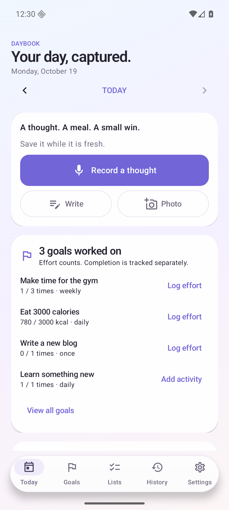
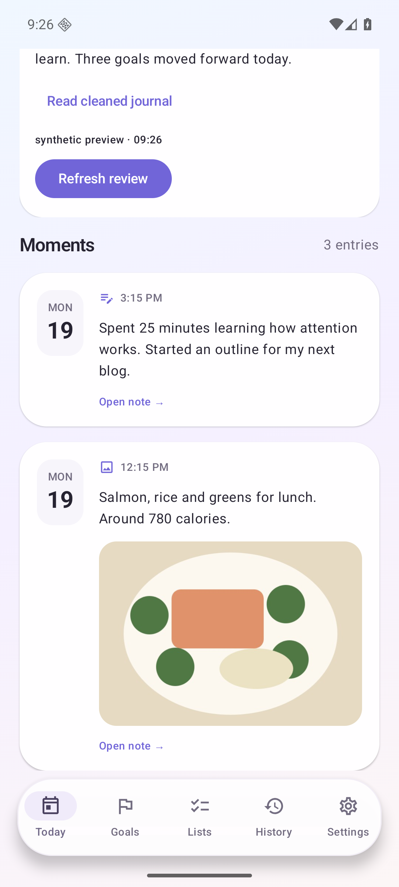
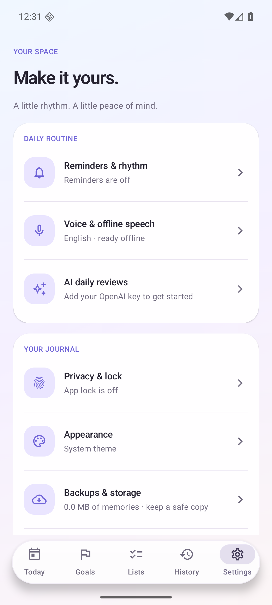
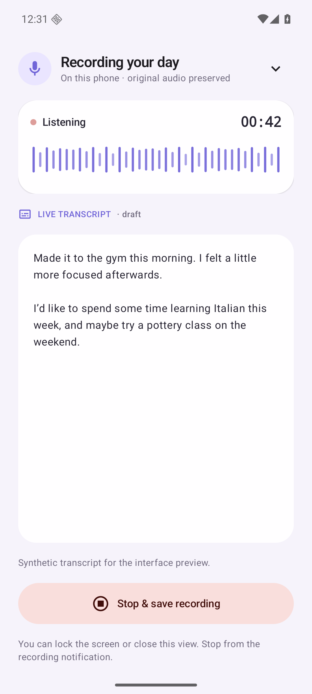
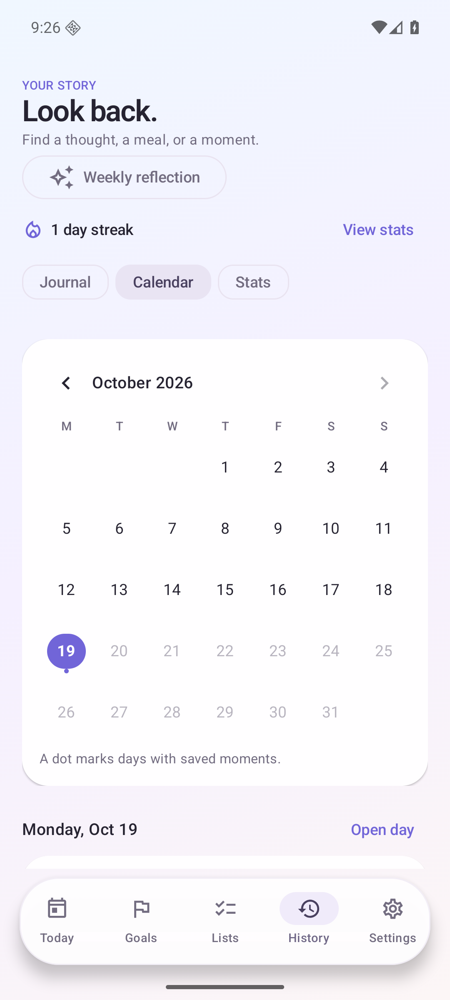
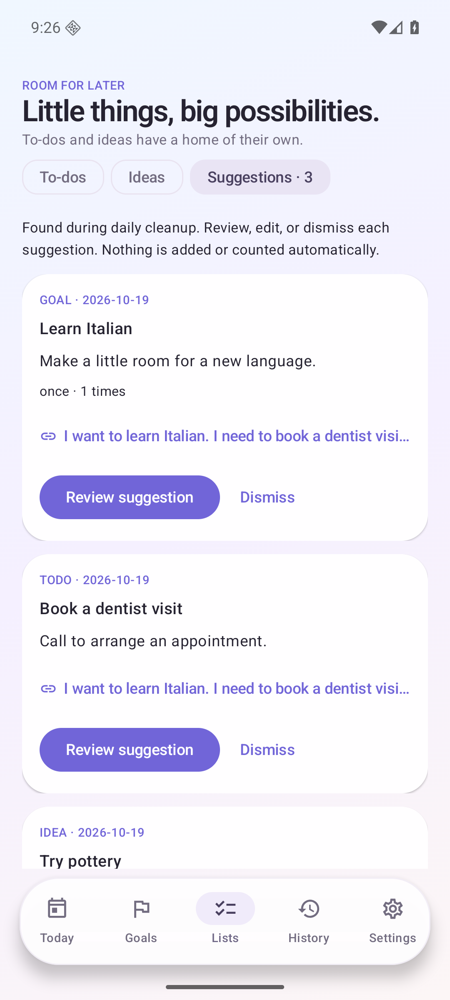

# Daybook

A personal Android journal for thoughts, voice notes, everyday photos, and the goals you want to make time for. Built with Kotlin and Jetpack Compose for Android 12+, with the Galaxy S26 Ultra as the intended phone.

## Preview

Synthetic sample journal, captured from the running Android app. The meal illustration, review text and planning suggestions shown in the screenshots are fixtures. The recording screenshot shows actual emulator capture with no detected speech. Transcript and note-editor screenshots use synthetic text; the dark save-error screenshot simulates a failed save.

| Today | Journal | Settings |
| --- | --- | --- |
|  |  |  |

## Start on your phone

[GitHub repository](https://github.com/agentcap/daybook) contains source code only. APK/AAB files are local build artifacts and are not uploaded. Build an APK using the instructions below; paths under `releases/` refer to artifacts on the original build machine.

1. Install `releases/daybook-0.6.2-beta.1.apk`, or build the APK below. This is a signed, non-debuggable build for personal installation.
2. Choose your waking hours, reminder interval, and nightly reflections time during onboarding. Grant notification permission for check-ins.
3. Open **Settings → Voice & offline speech**, choose Whisper, Moonshine v2 Small/Medium, or Parakeet TDT v2, then download that model once. Recording works before downloading; retry saved recordings afterwards.
4. Create goals from Goals → New goal. Templates include gym, cooking, laundry, blogging, learning, and 3000 calories.
5. For daily AI reviews, open **Settings → AI reflections**. Choose **On-device** and download its model for offline text reflections, or choose **OpenAI**, save your own API key, and turn on **Allow OpenAI reflections**. Capture and manual tracking need no key.

A note can be written, recorded, or photographed. Tap a saved note to play its original audio, inspect its original text and earlier revisions, edit it, retry transcription, or delete it.

The Today screen shows **distinct goals worked on that day**. Logging partial effort counts even with amount zero; completing a goal is separate. Daily and weekly numeric progress is calculated by the app. Weekly goals use Monday–Sunday, and historical views only include activity through the selected day.

OpenAI reviews include the selected day's eligible note text and journal-attached photos, following each note's privacy choices. The phone's other photos are not included. On-device reviews use note text only. Original audio is never sent for transcription or cleanup. Open a note to keep it on-device or exclude its photos from future cloud reviews. Manual OpenAI reflections previews eligible notes, photos, and context before sending. Generated reviews have their own revision history. Goal and calorie suggestions require your confirmation and can be edited, dismissed, or undone. A later note/edit marks the review outdated; refresh it to include the new content.

## Choose offline speech

Open **Settings → Voice & offline speech** to select a model and download it. The app supports:

| Model | Download | Recording preview |
| --- | ---: | --- |
| Whisper base.en | 141.1 MiB | Optional live drafts |
| Moonshine v2 Small | 135.7 MiB | After saving |
| Moonshine v2 Medium | 256.7 MiB | After saving |
| Parakeet TDT 0.6B v2 (int8) | 630.6 MiB | After saving |

All four run locally in airplane mode after installation. Downloads show per-model progress, resume partial files, and verify each component before marking the model ready. **Processing & downloads** lists all installed/downloadable models; **Remove selected speech model** frees its storage without deleting notes. There is no silent fallback to a different model or cloud service.

The selection is saved immediately. A recording and its queued transcription keep the model chosen when recording started. An explicit retry uses the current selection. Open a saved voice note → **Transcribe again** to try a different model; previous text stays in revision history, original text/audio remain available, and saved corrections are protected from already-running jobs.

New models process bounded 30-second windows to limit audio memory. Segment timestamps are approximate, and words at window boundaries may need editing. Larger models use more memory and can take longer. Current correctness checks passed on an x86-64 Android 36 emulator; phone speed, battery use, and sustained transcription still need physical Pixel/Samsung testing. See [speech runtime and model pins](docs/speech-models.md) and [the model chooser](docs/screenshots/33-speech-models.png).

## Choose local or cloud reviews

In OpenAI settings, the model field and Save model control scroll above the keyboard. Bottom navigation is hidden while typing in Settings. Use **Save model** or the keyboard’s **Done** action to save; invalid names show an inline error. The API-key field also keeps its Save control reachable. [See model editing with the keyboard open](docs/screenshots/37-openai-model-keyboard.png).

In **Settings → AI reflections**, choose **On-device** for note-text reflections, summaries, goal progress, and new goal/to-do/idea suggestions without an API key. Download the Qwen 2.5 1.5B review model once (1.1 GB), then use **Create daily reflection** or automatic nightly reflections in airplane mode. This download is separate from the speech model. Its hash is checked before installation; pause/resume and removal are available in Settings.

Local reviews preserve original notes and use the same source checks and approval rules as OpenAI. Photos remain attached but are **not analyzed locally**. Add a caption or note for a photo-only day, or choose OpenAI for image understanding. There is no automatic cloud fallback. Longer days can take minutes or exceed the local context/output limits; failures preserve all originals. Performance on a physical S26 Ultra remains to be measured.

Switching providers requeues unfinished cleanup with the appropriate network requirements. A request already sent to OpenAI cannot be retracted. The local model stays outside APKs, Git, and backups; download it again after restoring on a new phone. See [local model details](docs/local-model.md).

## Room to write

Write opens a full-screen editor with a date, a spacious note field, and a Save button that remains above the keyboard. The keyboard opens automatically; sentences use your keyboard's capitalization and correction settings. A word count and keyboard show/hide button sit below the editor. The layout compacts in landscape.

Draft text and cursor selection survive activity recreation and rotation. Closing a changed draft asks whether to keep writing or discard it. Save errors keep your words on screen, and Save is disabled during a request to prevent repeat submissions. Notes are saved only when you tap Save; this is not automatic draft storage after you close the editor. With a hardware keyboard, Ctrl+Enter saves.

Open a saved entry and choose **Edit note** (or **Edit photo note**) for the same focused view. Saving retains original text and revision history. The recording transcript editor uses the same writing font and sentence keyboard options.

[Portrait writing with the keyboard](docs/screenshots/34-writing-note.png) · [Landscape writing](docs/screenshots/35-writing-landscape.png) · [Dark editor with a simulated save error](docs/screenshots/36-writing-save-error-dark.png).

## Recording, reflection, and plans

The recording view shows elapsed time and microphone levels. With Whisper selected, optional local draft transcripts appear while recording. Moonshine and Parakeet transcribe after saving. Download your selected model once, then use it offline. Previews process short windows beginning after three seconds; text can arrive later on slower devices. Pause and resume without adding pause-time silence. Use Discard to confirm removal of the current recording and its live draft; earlier entries and reflections remain saved. Mark a moment with an audio bookmark; after processing, use Transcript timeline in the note to seek to a segment of the original audio. Segment times are approximate. Stopping saves the original audio and queues a fuller transcription. On that same screen, tap **Edit transcript**, correct or add text, then **Save changes**. Editing also works while the fuller transcript is processing: incoming text does not replace your draft, and saved corrections are protected from later transcription. Cancel returns to the saved transcript; closing with unsaved edits asks before discarding them. Original audio and transcript revisions stay saved. Minimize the view to browse the app, or lock the screen while recording. Draft text survives a failed final transcription.

[See the saved-transcript editor](docs/screenshots/31-edit-saved-transcript.png) and [the corrected recording](docs/screenshots/32-transcript-corrected.png).

History offers **Journal**, **Calendar**, and **Stats** views. Select a date to browse its original notes or open the day. Stats show saved notes, journal days, photos, goal check-ins, your current streak, and your longest streak. A streak counts consecutive dates with a saved note, with today available to continue yesterday's streak. Goal check-ins count each goal once per day; goal activity alone does not extend a journaling streak.

**Lists** keeps to-dos and ideas outside the journal. Add and edit them manually, mark to-dos done or ideas tried, and archive them. During cleanup, either review provider can propose goals, concrete to-dos, and ideas from your notes. Review their supporting entries, edit the details, and approve or dismiss each proposal in **Lists → Suggestions**. Creating a goal never counts as working on it. Regenerated reviews retain your decisions, and unused creations can be undone.

| Recording | Calendar | Lists |
| --- | --- | --- |
|  |  |  |

## Make it yours

The visual style takes inspiration from [Reflection](https://www.reflection.app/): a soft lavender/blue backdrop, white rounded cards, inset journal photos, date badges, and a floating pill navigation bar. Daybook keeps its own branding and uses no Reflection assets. Compact type gives notes more room while following Android’s font-size preference. Page transitions, changing card sizes, progress indicators, list updates, and recording levels use subtle animations.

Settings is a focused menu: **Reminders & rhythm**, **Voice & offline speech**, **AI reflections**, **Privacy & lock**, **Appearance**, **Backups & storage**, and **Home-screen widgets**. Choose times with a time picker and an interval from a list, then tap **Save rhythm**. Privacy, theme, and AI switches save immediately; the API key and model have their own save buttons. Errors and successful saves appear on the page.

Enable **Settings → Privacy & lock → Fingerprint & screen lock** to show Android authentication automatically whenever you open or return to Daybook. With an enrolled fingerprint, use the sensor immediately; your device PIN/pattern/password is also available. Dismissing the prompt leaves the journal locked and allows a manual retry. Background cleanup and an existing recording continue.

### Capture from your home screen

- Open **Settings → Home-screen widgets → Add Note & Voice widget**, then accept your launcher's Add prompt. This dark 2 × 1 widget has separate **Write** and **Record** buttons. Write opens a new note; Record starts voice capture.
- **Add Record widget** offers the existing compact 1 × 1 microphone tile. The larger dark 3 × 1 Record/Write/Photo strip is also available.
- Or touch and hold an empty area on the home screen → **Widgets → Daybook → Daybook Note & Voice** (or choose either existing widget).
- [See the actual emulator home-screen widgets](docs/screenshots/30-note-voice-widget.png).
- Tap the microphone: Daybook opens and starts recording immediately, with no Start confirmation. If app lock is enabled, authenticate first. Grant microphone permission on the first recording and complete onboarding once.
- Stop using **Stop & save** in the persistent recording notification or on Today. Repeated widget taps while recording do not create another recording.
- After updating, touch and hold an existing widget to resize it, or remove/re-add it to apply the smaller default footprint. Removing a widget does not delete journal entries. Launcher cell sizes vary; [Android widget sizing](https://developer.android.com/develop/ui/views/appwidgets/layouts) describes the requested defaults.

Install this APK over 0.1.0, 0.2.0, 0.3.0, 0.4.0, 0.4.1, 0.5.0-beta.1, 0.5.1-beta.1, 0.5.2-beta.1, 0.5.3-beta.1, 0.6.0-beta.1, or 0.6.1-beta.1 to retain existing notes and settings. It uses the same private signing key; no uninstall is needed.

## Build

From Ubuntu/WSL, with Python 3.12+, Git, and internet access:

```sh
git submodule update --init --depth 1
python3 scripts/bootstrap.py
bash scripts/build.sh :core:test :app:testVerificationUnitTest :app:lintDebug :app:assembleDebug
```

Bootstrap downloads a project-local JDK and Android SDK/NDK, verifies published archive checksums, and accepts the Android SDK licenses needed to build. Tool downloads and caches are ignored by Git. You can supply existing `JAVA_HOME` and `ANDROID_HOME` instead.

For the signed personal release:

```sh
python3 scripts/create-signing-key.py
bash scripts/build.sh :app:assembleRelease
```

Personal APK: `app/build/outputs/apk/release/app-release.apk`. Developer APK: `app/build/outputs/apk/debug/app-debug.apk`. ARM64 for phones and x86-64 for emulator checks are included. Gradle, Android plugins, direct libraries, whisper.cpp, llama.cpp, and speech/review model revisions/checksums are pinned. The build script downloads checksum-pinned Moonshine and Sherpa Android runtime AARs; model weights stay outside APKs. Run `python3 scripts/speech-dependencies.py` before a direct Android Studio/Gradle build.

On this computer, the initial build reused the installed toolchain under `/home/pyarla/splitwise_ai/.tools/android/` through ignored local configuration; the new app has no source or runtime dependency on that project.

To install over USB from Windows after enabling USB debugging and accepting the phone's authorization prompt:

```powershell
powershell -ExecutionPolicy Bypass -File .\scripts\install.ps1
```

Alternatively, copy the APK to the phone and open it. Keep the private `.tools/signing/` folder (both the key and password file) used for the personal release to install future updates without uninstalling. An uninstall removes the journal; create an encrypted backup first.

## Verify

```sh
bash scripts/build.sh :core:test :app:testVerificationUnitTest :app:lintDebug :app:assembleDebug
# Start a separate emulator, after installing the Android 36 Google APIs x86_64 image:
bash scripts/emulator.sh
# In another terminal:
bash scripts/build.sh :app:connectedVerificationAndroidTest
```

Instrumentation uses a separate `dev.daybook.app.verification` package, so it does not access the personal app's storage. Normal tests cover journal/goal/search workflows, list approvals and undo, calendar/stats, recording controls, retained live drafts, originals and photo persistence, encrypted backup round trips with proposals and media, invalid passwords, path traversal rejection, and WAV recovery.

Optional real-model checks download the actual model and test transcription with airplane mode enabled **on an emulator**:

```sh
bash scripts/build.sh :app:connectedVerificationAndroidTest \
  -Pandroid.testInstrumentationRunnerArguments.class=dev.daybook.app.RealSpeechTest \
  -Pandroid.testInstrumentationRunnerArguments.realSpeech=true
```

See [verification results and phone checks](docs/verification.md), [privacy and backup details](docs/privacy.md), and [architecture](docs/architecture.md).

## Daily rhythm and privacy

Reminders follow three-hour slots from your chosen waking time, inside waking hours. They support a 30-minute snooze. Nightly reflections and manual reflections queue when offline. Reboot and clock/time-zone changes reschedule future work; recorded journal dates and capture time zones remain unchanged.

Android Doze, Samsung sleeping-app controls, force-stop, and network availability can delay work. Review notification and battery settings if check-ins are missing. This app intentionally uses approximate reminders without requesting exact-alarm permission.

Use full encrypted backup/restore to preserve audio and photos. Automatic daily backups can write to a folder you select and retain seven successful copies. The backup passphrase is remembered with Android Keystore only after explicit consent and is excluded from exported backups. Disabling the schedule removes that saved secret. Markdown export is a readable text export with attachment identifiers, not a media backup. Keep your backup passphrase safe: it cannot be recovered. Android cloud backup and automatic device transfer are excluded.

## Source

- `app`: Android UI, Room persistence, DataStore preferences, capture, reminders, OpenAI client, backups, widget, and biometric gate.
- `core`: journal models, goal calculations, review validation, local structured-output grammar, scheduling rules, and segmented encrypted archive format.
- `local-llm`: isolated llama.cpp Android binding for local text reviews. Its native symbols are kept separate from whisper.cpp.
- `vendor/whisper.cpp`: pinned upstream submodule, v1.8.7 / `48f628a84833905ee4a0658ee6d4a5c915ce1997`.

## Beta release additions

- **Recently Deleted:** moving a note hides its audio/photos and source-linked reviews. Restore within 30 days or permanently delete from Settings → Backups & storage → Recently Deleted. Background maintenance removes expired trash when Android permits; confirmed goal counts remain.
- **Automatic backups & recovery:** daily passphrase-encrypted backups to a user-selected document folder, last success/error status, seven-copy retention, and a manual Run now action. A cloud document provider may sync the encrypted files under its own terms.
- **Weekly reflection:** History → Weekly reflection combines source notes, current daily summaries, confirmed goal/day check-ins, open items, and an editable personal reflection. This view makes no additional AI request.
- **Processing & downloads:** see transcription/review status, retry or cancel, choose unmetered-only model downloads, or require charging for cleanup.
- **Privacy policy & feedback:** read the local policy, inspect license notices, and share a feedback draft. Optional diagnostic details are visible before sharing and exclude journal content, keys, paths, and identifiers.
- **Accessibility:** labeled full-row switches, larger minimum navigation/touch sizes, scalable system fonts, and a reduced-animation option.

The backup manifest is version 2. This app restores versions 1 and 2. Older app versions reject a version-2 backup instead of silently dropping privacy, trash, timestamp, or reflection data.

## Google Play preparation

Build the signed bundle with `bash scripts/build.sh :app:bundleRelease`. The local beta supports personal APK installation; public publication still requires publisher details, a hosted privacy policy, real-device results, accurate Console declarations, and the applicable closed beta. See [publishing preparation](publishing/README.md). No store upload or external policy hosting happens automatically.

Later additions: optional mood/energy check-ins, tags, and goal consistency trends.


## Recording discard update

Version 0.5.1-beta.1 adds Discard beside Save recording. Confirming removes that recording’s audio and live draft; Keep recording returns to capture. Earlier entries and reflections stay saved. Discard is available while starting, recording, or paused, before final saving begins.

The former Clean up now action is Create daily reflection. Settings uses AI reflections, Automatic nightly reflections, and Create reflections only while charging. This changes the wording, not your existing schedule, privacy choices, or provider.
