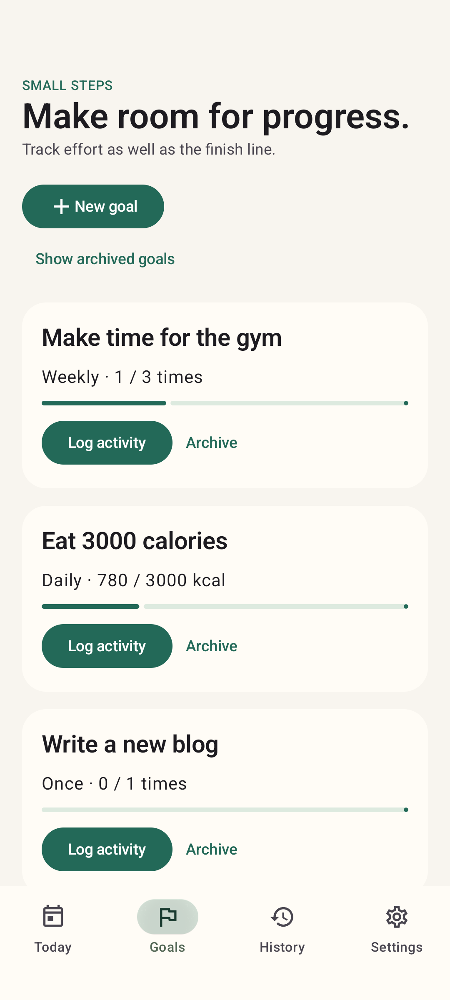
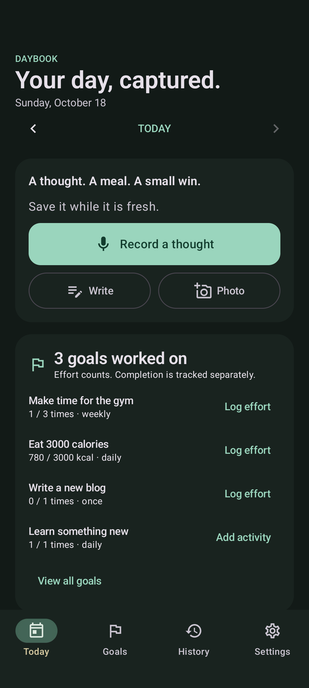

# Daybook

A personal Android journal for thoughts, voice notes, everyday photos, and the goals you want to make time for. Built with Kotlin and Jetpack Compose for Android 12+, with the Galaxy S26 Ultra as the intended phone.

## Preview

Synthetic sample journal, captured from the running Android app. The meal illustration and review text are fixtures.

| Today | Goals | Dark theme |
| --- | --- | --- |
|  |  |  |

## Start on your phone

1. Install `releases/daybook-0.1.0.apk`, or build the APK below. This is a signed, non-debuggable build for personal installation.
2. Choose your waking hours, reminder interval, and nightly cleanup time during onboarding. Grant notification permission for check-ins.
3. Download the English speech model (141 MB) once. Recording works before the download; saved recordings can be transcribed afterwards.
4. Create goals from Goals → New goal. Templates include gym, cooking, laundry, blogging, learning, and 3000 calories.
5. For daily AI reviews, enable **Send notes and attached photos**, enter your own OpenAI API key, and save settings. Offline capture and manual goal tracking need no key.

A note can be written, recorded, or photographed. Tap a saved note to play its original audio, inspect its original text and earlier revisions, edit it, retry transcription, or delete it.

The Today screen shows **distinct goals worked on that day**. Logging partial effort counts even with amount zero; completing a goal is separate. Daily and weekly numeric progress is calculated by the app. Weekly goals use Monday–Sunday, and historical views only include activity through the selected day.

AI reviews include the selected day's note text and **all photos attached to its journal**, rather than the phone's entire gallery. Original audio never leaves the phone. Generated reviews have their own revision history. Goal and calorie suggestions require your confirmation and can be edited, dismissed, or undone. A later note/edit marks the review outdated; refresh it to include the new content.

## Build

From Ubuntu/WSL, with Python 3.12+, Git, and internet access:

```sh
git submodule update --init --depth 1
python3 scripts/bootstrap.py
bash scripts/build.sh :core:test :app:testVerificationUnitTest :app:lintDebug :app:assembleDebug
```

Bootstrap downloads a project-local JDK and Android SDK/NDK, verifies published archive checksums, and accepts the Android SDK licenses needed to build. Tool downloads and caches are ignored by Git. You can supply existing `JAVA_HOME` and `ANDROID_HOME` instead.

For the signed personal release:

```sh
python3 scripts/create-signing-key.py
bash scripts/build.sh :app:assembleRelease
```

Personal APK: `app/build/outputs/apk/release/app-release.apk`. Developer APK: `app/build/outputs/apk/debug/app-debug.apk`. ARM64 for phones and x86-64 for emulator checks are included. Gradle, Android plugins, direct libraries, whisper.cpp, and the speech model revision/checksum are pinned.

On this computer, the initial build reused the installed toolchain under `/home/pyarla/splitwise_ai/.tools/android/` through ignored local configuration; the new app has no source or runtime dependency on that project.

To install over USB from Windows after enabling USB debugging and accepting the phone's authorization prompt:

```powershell
powershell -ExecutionPolicy Bypass -File .\scripts\install.ps1
```

Alternatively, copy the APK to the phone and open it. Keep the private `.tools/signing/` folder (both the key and password file) used for the personal release to install future updates without uninstalling. An uninstall removes the journal; create an encrypted backup first.

## Verify

```sh
bash scripts/build.sh :core:test :app:testVerificationUnitTest :app:lintDebug :app:assembleDebug
# Start a separate emulator, after installing the Android 36 Google APIs x86_64 image:
bash scripts/emulator.sh
# In another terminal:
bash scripts/build.sh :app:connectedVerificationAndroidTest
```

Instrumentation uses a separate `dev.daybook.app.verification` package, so it does not access the personal app's storage. Normal tests cover journal/goal/search workflows, originals and photo persistence, encrypted backup round trips, invalid passwords, path traversal rejection, and WAV recovery.

Optional real-model checks download the actual model and test transcription with airplane mode enabled **on an emulator**:

```sh
bash scripts/build.sh :app:connectedVerificationAndroidTest \
  -Pandroid.testInstrumentationRunnerArguments.class=dev.daybook.app.RealSpeechTest \
  -Pandroid.testInstrumentationRunnerArguments.realSpeech=true
```

See [verification results and phone checks](docs/verification.md), [privacy and backup details](docs/privacy.md), and [architecture](docs/architecture.md).

## Daily rhythm and privacy

Reminders follow three-hour slots from your chosen waking time, inside waking hours. They support a 30-minute snooze. Nightly cleanup and manual cleanup queue when offline. Reboot and clock/time-zone changes reschedule future work; recorded journal dates and capture time zones remain unchanged.

Android Doze, Samsung sleeping-app controls, force-stop, and network availability can delay work. Review notification and battery settings if check-ins are missing. This app intentionally uses approximate reminders without requesting exact-alarm permission.

Use full encrypted backup/restore to preserve audio and photos. Markdown export is a readable text export with attachment identifiers, not a media backup. Keep your backup passphrase safe: it cannot be recovered. Android cloud backup and automatic device transfer are excluded.

## Source

- `app`: Android UI, Room persistence, DataStore preferences, capture, reminders, OpenAI client, backups, widget, and biometric gate.
- `core`: journal models, goal calculations, review validation, scheduling rules, and segmented encrypted archive format.
- `vendor/whisper.cpp`: pinned upstream submodule, v1.8.7 / `48f628a84833905ee4a0658ee6d4a5c915ce1997`.

Future additions: weekly reflections, optional mood/energy check-ins, and goal consistency trends.
